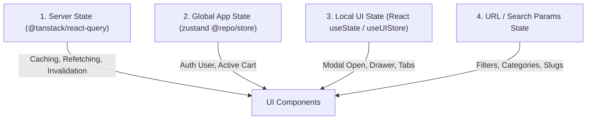

# TỔNG QUAN TOÀN DIỆN KIẾN TRÚC, CÔNG NGHỆ & QUY TẮC DỰ ÁN EATZY FRONTEND (`eatzy_frontend`)

> **Phiên bản tài liệu**: 1.0.0  
> **Hệ thống**: Nền tảng Siêu Ứng Dụng Ẩm Thực & Giao Vận Đa Đối Tượng Eatzy (Eatzy Web Ecosystem)  
> **Kiến trúc**: Monorepo (Turborepo + pnpm Workspace)  
> **Ngôn ngữ**: 100% TypeScript Strict Mode  

---

## MỤC LỤC TỔNG THỂ

1. [Tổng Quan Nền Tảng & Triết Lý Thiết Kế](#1-tổng-quan-nền-tảng--triết-lý-thiết-kế)
2. [Hạ Tầng Monorepo & Công Cụ Cốt Lõi (Core Tooling)](#2-hạ-tầng-monorepo--công-cụ-cốt-lõi-core-tooling)
3. [Phân Tích Chi Tiết 5 Ứng Dụng Con (`apps/*`)](#3-phân-tích-chi-tiết-5-ứng-dụng-con-apps)
   - 3.1. `apps/customer` (Cổng Thực Khách - Port 3000)
   - 3.2. `apps/driver` (Cổng Đối Tác Tài Xế - Port 3001)
   - 3.3. `apps/restaurant` (Cổng Đối Tác Nhà Hàng & Bếp - Port 3002)
   - 3.4. `apps/super-admin` (Cổng Quản Trị Hệ Thống Toàn Diện - Port 3003)
   - 3.5. `apps/admin` (Cổng Quản Trị Điều Hành Nội Bộ - Port 3004)
4. [Phân Tích Chi Tiết 17 Gói Thư Viện Dùng Chung (`packages/*`)](#4-phân-tích-chi-tiết-17-gói-thư-viện-dùng-chung-packages)
   - 4.1. `@repo/api` (Tầng Giao Tiếp Mạng & Dual-Mode Mock Adapter)
   - 4.2. `@repo/ui` (Design System, Shimmer Suite, Form & Navigation Primitives)
   - 4.3. `@repo/store` (Zustand Global State Management & Persistence)
   - 4.4. `@repo/mock` (Relational In-Memory State Machine & Mock Database)
   - 4.5. `@repo/types` (Domain TypeScript Type Definitions)
   - 4.6. `@repo/socket` (STOMP over SockJS Real-time WebSocket Protocol)
   - 4.7. `@repo/lib` (Utilities, Formatters & QueryProvider)
   - 4.8. `@repo/hooks` (Cross-app React Custom Hooks)
   - 4.9. `@repo/fonts` (Antonio Typography Suite)
   - 4.10. `@repo/models` (Entity Models & Enums)
   - 4.11. `@repo/typescript-config` (Shared Compiler Configurations)
   - 4.12. `@repo/eslint-config` (Shared Code Quality Rules)
   - 4.13. `@repo/config`, `@repo/mappers`, `@repo/middleware`, `@repo/utils`, `@repo/validation`
5. [Quy Tắc Kiến Trúc & Thiết Kế Phần Mềm (Design Patterns & Conventions)](#5-quy-tắc-kiến-trúc--thiết-kế-phần-mềm-design-patterns--conventions)
   - 5.1. Mô hình Feature-First Slice Architecture (Domain-Driven Slices)
   - 5.2. Quản Lý Trạng Thái 4 Tầng (Four-Tier State Strategy)
   - 5.3. Chiến Lược Bảo Mật & Xác Thực JWT (In-Memory Token + HttpOnly Refresh)
   - 5.4. Phong Cách Thiết Kế Đặc Trưng (Editorial / Magazine Luxury Aesthetics)
   - 5.5. Chiến Lược PWA & Offline (Serwist Service Worker Caching)
   - 5.6. Quy Chuẩn Docker & Triển Khai Containerized Standalone

---

## 1. TỔNG QUAN NỀN TẢNG & TRIẾT LÝ THIẾT KẾ

`eatzy_frontend` là nền tảng giao diện web hợp nhất phục vụ toàn bộ chu trình cung ứng và trải nghiệm ẩm thực:
- **Khách hàng (Customer)**: Khám phá nhà hàng, đặt món trải nghiệm tạp chí thời thượng, đặt bàn (booking), giỏ hàng đa quán, thanh toán ví/cổng điện tử, theo dõi lộ trình thời gian thực.
- **Tài xế (Driver)**: Điều phối chuyến xe, radar quét đơn bán kính xung quanh, đếm ngược nhận cuốc 15s, dẫn đường bản đồ, quản lý ví thu nhập và rút tiền.
- **Nhà hàng (Restaurant/Merchant)**: Quản lý đóng/mở quán quẹt bảo mật, hệ thống điều phối bếp KDS (Kitchen Display System), quản lý thực đơn, mã giảm giá, bàn ăn và báo cáo doanh thu chi tiết.
- **Quản trị viên (Super Admin & Admin)**: Giám sát toàn hệ thống, cấu hình tham số động, phân quyền RBAC đa cấp, quản trị tài chính, đối tác và người dùng.

Dự án áp dụng phương pháp thiết kế **Editorial / Magazine Luxury**:
- Sử dụng typography ấn tượng: Font Display `Antonio` phối hợp cùng `Bebas`, `Oswald` và `Inter`.
- Bảng màu chủ đạo: `Primary (#78C841)`, `Secondary (#B4E50D)`, `Eatzy Lime (#84CC16)` trên nền tối sâu `Dark Surface (#0B0C0E / #14171D / #1C2029)`.
- Kỹ thuật bề mặt: Hiệu ứng kính bán trong suốt (Glassmorphism), viền capsule mềm mại, tương tác cử chỉ trượt xác nhận (`SwipeToConfirm`), chuyển động mượt mà bằng `framer-motion`.

---

## 2. HẠ TẦNG MONOREPO & CÔNG CỤ CỐT LÕI (CORE TOOLING)

### 2.1. Cấu hình Monorepo
- **Quản lý Workspace**: `pnpm@9.0.0` (khai báo trong `package.json` cấp root: `"packageManager": "pnpm@9.0.0"`).
- **Phạm vi Workspace (`pnpm-workspace.yaml`)**:
  ```yaml
  packages:
    - "apps/*"
    - "packages/*"
  ```
  Cho phép 5 ứng dụng con và 17 gói thư viện liên kết thông qua cú pháp nội bộ `workspace:*`.
- **Cấu hình Trình Quản Lý Gói (`.npmrc`)**:
  ```ini
  node-linker=hoisted
  shamefully-hoist=true
  auto-install-peers=true
  ```
  Đảm bảo cây phụ thuộc phẳng hóa, tương thích tối đa với công cụ đóng gói và các bộ phân giải module phức tạp.

### 2.2. Bộ Điều Phối Nhiệm Vụ Turborepo (`turbo.json`)
Turborepo quản lý đồ thị thực thi song song (Topological Task Graph) và bộ nhớ đệm (Computation Caching):
```json
{
  "$schema": "https://turborepo.com/schema.json",
  "ui": "tui",
  "tasks": {
    "build": {
      "dependsOn": ["^build"],
      "inputs": ["$TURBO_DEFAULT$", ".env*"],
      "outputs": [".next/**", "!.next/cache/**"]
    },
    "lint": {
      "dependsOn": ["^lint"]
    },
    "check-types": {
      "dependsOn": ["^check-types"]
    },
    "dev": {
      "cache": false,
      "persistent": true
    }
  }
}
```
- **Quy tắc Topo (`^build`, `^check-types`)**: Bắt buộc build/kiểm tra các thư viện tầng dưới (`packages/*`) trước khi build các ứng dụng tầng trên (`apps/*`).
- **Cache Đầu Ra**: Lưu `.next/**` để tái sử dụng kết quả build khi code không thay đổi.
- **Dev Mode**: Không lưu cache (`cache: false`) và duy trì tiến trình chạy ngầm (`persistent: true`).

---

## 3. PHÂN TÍCH CHI TIẾT 5 ỨNG DỤNG CON (`apps/*`)

### 3.1. `apps/customer` (Cổng Thực Khách)
- **Cổng mạng phát triển**: `http://localhost:3000` (`next dev -p 3000`).
- **Công nghệ & Thư viện sử dụng**:
  - **Framework**: `Next.js 14.2.33` (React 18 + React DOM 18).
  - **Data Fetching & Server State**: `@tanstack/react-query@^5.59.20`, `@tanstack/react-query-devtools@^5.91.2`.
  - **Bản đồ số**: `mapbox-gl@^3.16.0`, `react-map-gl@^8.1.0`.
  - **PWA & Offline**: `@serwist/next@^9.4.2`, `@serwist/precaching@^9.4.2`, `@serwist/sw@^9.4.2`, `serwist@^9.4.2`.
  - **Âm thanh & Hiệu ứng**: `sileo@^0.1.5`.
  - **Styling**: `tailwindcss@^3.4.1`, `postcss@^8`.
  - **Quản lý trạng thái client**: `zustand@^4.5.5`.
  - **Thư viện nội bộ**: `@repo/ui`, `@repo/api`, `@repo/store`, `@repo/mock`, `@repo/types`, `@repo/fonts`, `@repo/hooks`, `@repo/lib`, `@repo/models`, `@repo/socket`.
- **Cấu hình Next.js (`next.config.mjs`)**:
  - `output: 'standalone'`: Tối ưu hóa kích thước Docker container sản xuất.
  - `transpilePackages: ["@repo/ui", "@repo/models"]`.
  - Tích hợp Serwist PWA (`swSrc: "src/sw.ts"`, `swDest: "public/sw.js"`).
  - Proxy API rewrite: `/api/proxy/:path*` ➔ `https://eatzy-be.hoanduong.net/:path*`.
  - Cấu hình remotePatterns cho ảnh mở rộng toàn bộ http/https.
- **Cấu trúc Routing (`src/app/`)**:
  - `(public)`: `login/`, `register/`, `forgot-password/`.
  - `(protected)`:
    - `checkout/`: Luồng thanh toán đơn hàng.
    - `(normal)/`: Bố cục chính với thanh điều hướng `LiquidGlassNavigation`:
      - `home/`: Trang chủ tạp chí (`useHomePage`, `CategoryScroller`, `RestaurantSlider`, `RecommendedSection`).
      - `restaurants/`: Danh mục và chi tiết nhà hàng (`restaurants/[id]/`).
      - `orders/`: Đơn hàng đang xử lý (`CurrentOrdersDrawer`).
      - `order-history/`: Lịch sử đơn hàng và đánh giá.
      - `booking/`: Đặt bàn trực tiếp tại quán.
      - `favorites/`: Danh sách quán ăn yêu thích.
      - `messages/`: Kênh chat thời gian thực với tài xế và quán.
      - `profile/`: Quản lý tài khoản và địa chỉ giao nhận.
- **16 Feature Modules (`src/features/`)**:
  `auth`, `booking`, `cart`, `checkout`, `favorites`, `home`, `location`, `messages`, `navigation`, `orders`, `payment`, `profile`, `restaurant`, `search`, `socket`, `wallet`.
- **Zustand Store Nội Bộ**:
  - `uiStore.ts`: Quản lý trạng thái mở/đóng modal tìm kiếm, drawer đơn hàng, giỏ hàng popup.
  - `deliveryLocationStore.ts`: Quản lý tọa độ và địa chỉ giao hàng được chọn.
  - `transitionStore.ts`: Quản lý trạng thái chuyển cảnh giao diện.

---

### 3.2. `apps/driver` (Cổng Đối Tác Tài Xế)
- **Cổng mạng phát triển**: `http://localhost:3001` (`next dev -p 3001`).
- **Công nghệ & Thư viện sử dụng**:
  - `Next.js 14.2.33`, `React 18`, `@tanstack/react-query@^5.59.20`, `lucide-react@^0.460.0`.
  - `mapbox-gl@^3.16.0`, `react-map-gl@^8.1.0` (mô phỏng điều hướng GPS và lộ trình giao hàng).
  - PWA Serwist: Đảm bảo tài xế nhận thông báo đẩy kể cả khi chạy nền.
  - Thư viện nội bộ: `@repo/ui`, `@repo/api`, `@repo/store`, `@repo/mock`, `@repo/types`, `@repo/fonts`, `@repo/hooks`, `@repo/lib`, `@repo/socket`.
- **Cấu trúc Routing (`src/app/`)**:
  - `(public)`: `login/`, `register/`, `forgot-password/`.
  - `(protected)`:
    - `pending-review/`: Màn hình chờ duyệt hồ sơ đối tác tài xế mới.
    - `(normal)/`:
      - `home/`: Bảng điều khiển tài xế (`OnlineToggle`, radar tìm đơn, bộ đếm ngược nhận cuốc 15 giây, thẻ đơn hàng chủ động `ActiveOrderCard`).
      - `history/`: Lịch sử các cuốc giao thành công.
      - `wallet/`: Ví tài xế, xem số dư tức thì, yêu cầu rút tiền về tài khoản ngân hàng.
      - `messages/`: Nhắn tin thoại và tin nhắn nhanh với khách/quán.
      - `profile/`: Thông tin phương tiện, giấy phép lái xe.
      - `settings/`: Cài đặt nhận cuốc tự động và bán kính hoạt động.
- **13 Feature Modules (`src/features/`)**:
  `auth`, `booking`, `history`, `layout`, `map`, `messages`, `onboarding`, `online`, `orders`, `payment`, `profile`, `socket`, `wallet`.

---

### 3.3. `apps/restaurant` (Cổng Đối Tác Nhà Hàng & Quản Trị Bếp)
- **Cổng mạng phát triển**: `http://localhost:3002` (`next dev -p 3002`).
- **Công nghệ & Thư viện sử dụng**:
  - `Next.js 14.2.33`, `React 18`, `@tanstack/react-query@^5.59.20`.
  - **Biểu đồ & Thống kê**: `recharts@^2.12.7` (vẽ biểu đồ doanh thu, số lượng đơn theo giờ/ngày/tuần).
  - **Xử lý Thời gian**: `date-fns@^2.30.0` (quản lý ca làm việc, lịch đặt bàn).
  - `mapbox-gl`, `react-map-gl`, PWA Serwist.
  - Thư viện nội bộ: `@repo/ui`, `@repo/api`, `@repo/store`, `@repo/mock`, `@repo/types`, `@repo/fonts`, `@repo/hooks`, `@repo/lib`.
- **Cấu trúc Routing (`src/app/`)**:
  - `(public)`: `login/`, `register/`, `forgot-password/`.
  - `(protected)/(normal)/`:
    - `orders/`: Màn hình KDS điều phối đơn hàng 3 tab (`pending`, `in_progress`, `waiting_driver`).
    - `menu/`: Quản trị món ăn, danh mục món, tùy chọn món (topping, size, addon).
    - `store/`: Trạng thái hoạt động quán, thời gian mở/đóng cửa, thông tin liên hệ.
    - `history/`: Lịch sử đơn món và hóa đơn xuất cho kế toán.
    - `finances/` & `wallet/`: Báo cáo tài chính, quyết toán doanh thu, phí hoa hồng nền tảng.
    - `reports/`: Phân tích món bán chạy, tỷ lệ hủy đơn, khung giờ vàng.
    - `reviews/`: Phản hồi và đánh giá từ khách hàng.
    - `promotions/`: Tạo mã giảm giá (voucher), chiến dịch flash sale.
    - `profile/`: Thông tin thương hiệu nhà hàng.
- **10 Feature Modules (`src/features/`)**:
  `auth`, `booking`, `history`, `menu`, `orders`, `payment`, `profile`, `reports`, `store`, `wallet`.

---

### 3.4. `apps/super-admin` (Cổng Quản Trị Hệ Thống Toàn Diện)
- **Cổng mạng phát triển**: `http://localhost:3003` (`next dev -p 3003`).
- **Công nghệ & Thư viện sử dụng**:
  - `Next.js 14.2.33`, `React 18`, `@tanstack/react-query@^5.59.20`, `recharts@^2.12.7`, `date-fns@^2.30.0`.
  - Thư viện nội bộ: `@repo/ui`, `@repo/api`, `@repo/store`, `@repo/mock`, `@repo/types`, `@repo/fonts`, `@repo/lib`.
- **Cấu trúc Routing (`src/app/`)**:
  - `(public)`: `login/`.
  - `(protected)/(normal)/`:
    - `dashboard/`: Trung tâm chỉ huy, 4 KPI cards tổng quan (doanh thu toàn sàn, lượng đơn hôm nay, tài xế đang trực tuyến, nhà hàng đối tác mới), biểu đồ tăng trưởng tuần.
    - `customers/`: Quản lý danh sách thực khách, khóa/mở tài khoản, lịch sử khiếu nại.
    - `drivers/`: Quản lý đội ngũ tài xế, xét duyệt bằng lái/giấy tờ xe, khóa tài khoản vi phạm.
    - `restaurants/`: Xét duyệt nhà hàng mới mở quán, kiểm tra an toàn thực phẩm.
    - `finance/`: Đối soát dòng tiền toàn sàn, phí dịch vụ Eatzy, phê duyệt lệnh rút tiền.
    - `promotions/`: Phê duyệt các chương trình khuyến mãi toàn sàn.
    - `permissions/`: Phân quyền RBAC cho các cấp quản trị viên.
    - `system-config/`: Thiết lập tham số động (bán kính quét tài xế, phí ship mặc định theo km, tỷ lệ chiết khấu, bật/tắt chế độ bảo trì).
- **8 Feature Modules (`src/features/`)**:
  `auth`, `customers`, `dashboard`, `drivers`, `finance`, `promotions`, `restaurants`, `system-config`.

---

### 3.5. `apps/admin` (Cổng Quản Trị Điều Hành Nội Bộ)
- **Cổng mạng phát triển**: `http://localhost:3004` (`next dev -p 3004`).
- **Công nghệ & Thư viện sử dụng**:
  - `Next.js 14.2.33`, `React 18`, `@repo/ui`, `@repo/api`, `@repo/store`, `@repo/lib`.
- **Cấu trúc Routing (`src/app/(protected)/`)**:
  Gồm 18 phân hệ nghiệp vụ chi tiết phục vụ kiểm soát vận hành nội bộ:
  `analytics`, `booking`, `categories`, `customers`, `dashboard`, `drivers`, `orders`, `permissions`, `profile`, `promotions`, `restaurant-areas`, `restaurant-shifts`, `restaurants`, `reviews`, `roles`, `settings`, `users`, `wallet`.

---

## 4. PHÂN TÍCH CHI TIẾT 17 GÓI THƯ VIỆN DÙNG CHUNG (`packages/*`)

### 4.1. `@repo/api` (Tầng Giao Tiếp Mạng & Dual-Mode Mock Adapter)
- **Dependencies**: `axios@^1.7.7`, `@repo/types`, `@repo/mock`.
- **Cơ chế Dual-Mode (`src/http.ts`)**:
  - Cung cấp hàm `isMockModeEnabled()`: Tự động bật chế độ Mock ở môi trường local development (lưu cờ `eatzy_mock_mode` trong `localStorage` hoặc đọc `NEXT_PUBLIC_ENABLE_MOCK`).
  - Khi bật Mock: Interceptor của Axios chuyển hướng toàn bộ yêu cầu sang `handleMockRequest()`.
  - Khi tắt Mock: Gửi yêu cầu thật qua baseURL `/api/proxy` (được Next.js proxy tới Backend thực tế `https://eatzy-be.hoanduong.net`).
- **Quản lý Token An Toàn**:
  - Access Token được lưu hoàn toàn trong **biến bộ nhớ** (`let accessToken: string | null`), tuyệt đối không lưu trong localStorage để chống tấn công XSS.
  - Hàng đợi làm mới Token tự động (`Token Refresh Queue`): Khi nhận mã lỗi `401 Unauthorized`, hệ thống tự động tạm dừng các request khác, gọi endpoint `/auth/refresh` lấy token mới rồi phát lại toàn bộ request trong hàng đợi.
- **Bộ Chuyển Đổi Mock Đa Vai Trò (`src/mockAdapter.ts`)**:
  - Tự động nhận diện vai trò ứng dụng dựa trên cổng mạng đang truy cập:
    - Port `3000` ➔ Vai trò `customer`
    - Port `3001` ➔ Vai trò `driver`
    - Port `3002` ➔ Vai trò `restaurant`
    - Port `3003` / `3004` ➔ Vai trò `superAdmin`
  - Ánh xạ đường dẫn REST API bằng Regex để trích xuất ID (ví dụ: `/api/v1/orders/1001/restaurant/accept`).
- **Danh Mục API Endpoint Services (`src/`)**:
  `address.ts`, `auth.ts`, `cart.ts`, `chat.ts`, `customer.ts`, `driver.ts`, `favorite.ts`, `file.ts`, `order/`, `report.ts`, `restaurant/`, `review.ts`, `system-config.ts`, `user.ts`, `voucher.ts`, `wallet.ts`.

---

### 4.2. `@repo/ui` (Design System, Shimmer Suite, Form & Navigation Primitives)
- **Dependencies**: `framer-motion@^11.0.0`, `lucide-react@^0.460.0`, `clsx@^2.1.0`.
- **Cấu trúc Thư Mục & Thành Phần**:
  1. **`primitives/`**:
     - `Button.tsx`: Nút bấm thiết kế theo mô hình **Recipe Pattern** (`buttonRecipe({ variant, size })`), hỗ trợ 7 biến thể (`primary`, `secondary`, `warning`, `danger`, `outline`, `ghost`, `glass`) và 3 kích cỡ (`sm`, `md`, `lg`).
     - `SwipeToConfirm.tsx`: Thanh trượt cử chỉ xác nhận độc quyền của Eatzy, hỗ trợ cả sự kiện chuột (`MouseEvent`) và cảm ứng (`TouchEvent`) với tính toán giới hạn vị trí kéo mượt mà.
  2. **`feedback/shimmer/` (Bộ Sưu Tập 32 Component Shimmer Skeleton)**:
     Bao phủ mọi trạng thái chờ dữ liệu của nền tảng:
     `CartOverlayShimmer`, `CheckoutShimmer`, `CurrentOrderCardShimmer`, `CurrentOrdersDrawerShimmer`, `DataTableRowShimmer`, `DriverOrderDetailDrawerShimmer`, `FloatingRestaurantCartShimmer`, `HistoryCardShimmer`, `LiquidGlassMobileNavigationShimmer`, `MagazineLayout8Shimmer`, `MessageItemShimmer`, `MobileMenuShimmer`, `NavItemShimmer`, `OrderCardShimmer`, `OrderDetailDrawerShimmer`, `OrderDetailsModalShimmer`, `OrderHistoryCardShimmer`, `OrderReviewTabShimmer`, `PersonalInfoShimmer`, `ProfileAvatarCardShimmer`, `ProfileShimmer`, `RecentOrderCardShimmer`, `RestaurantCardShimmer`, `RestaurantDetailShimmer`, `RestaurantMenuShimmer`, `ReviewItemShimmer`, `ReviewStatsShimmer`, `SavedAddressesShimmer`, `TextShimmer`, `TransactionCardShimmer`, `TransactionRowShimmer`, `WalletTransactionsShimmer`.
  3. **`forms/` (Bộ Điều Khiển Nhập Liệu Chuẩn)**:
     `InputField`, `FloatingLabelInput`, `CustomSelect`, `NumberInput`, `TimeInput`, `CalendarDatePicker`, `DateRangePicker`, `PremiumDatePicker`, `AddressFields`, `PremiumAddressPicker`.
  4. **`navigation/`**:
     `LiquidGlassNavigation` (thanh điều hướng bo cong nổi hiệu ứng kính bóng), `AssistiveTouchNavigation` (nút điều hướng nổi thông minh), `NavItem`, `MobileNavItem`.
  5. **`modals/`**:
     `SwipeConfirmationModal`, `ProfileModal`, `ExportDataModal` (xuất dữ liệu bảng ra file).
  6. **`tables/`**:
     `DataTable` (bảng dữ liệu lớn tích hợp phân trang, sắp xếp), `DataTableFilter`, `TableFilterBadges`, `TableHeader`.
  7. **`providers/`**:
     `ThemeProvider` (Dark/Light mode), `SwipeConfirmationProvider` (hook `useSwipeConfirmation()`), `LoadingProvider` (hook `useLoading()`), `NotificationProvider`.
  8. **`tokens/`**:
     `colors.ts` (định nghĩa mã hex và hàm chuyển đổi `hexToRgb` phục vụ Tailwind CSS `<alpha-value>`).
  9. **`recipes/`**:
     `createRecipe.ts`, `button.ts` (mô hình tạo class động dựa trên variants và compoundVariants).
  10. **`data/`**:
      `vietnamAdministrative.ts` (dữ liệu hành chính 63 tỉnh thành Việt Nam, quận/huyện, phường/xã).
  11. **`motion.ts`**:
      Xuất khẩu tập trung các thành phần animation từ `framer-motion` (`motion`, `AnimatePresence`, `LayoutGroup`, `useScroll`, `useTransform`).
  12. **`card.tsx`, `code.tsx`, `button.tsx`**: Các component tiêu chuẩn cấp root.

---

### 4.3. `@repo/store` (Zustand Global State Management & Persistence)
- **Dependencies**: `zustand@^4.5.5`, `@repo/types`.
- **Thành phần cốt lõi**:
  1. **`useAuthStore` (`src/auth.ts`)**:
     - Quản lý trạng thái đăng nhập: `token`, `user`, `setLogin`, `logout`, `clearAuth`.
     - Sử dụng middleware `persist` với `localStorage`.
     - **Nguyên tắc bảo mật (Security Policy)**: Sử dụng hàm `partialize: (state) => ({ user: state.user })` để **chỉ lưu thông tin profile người dùng, tuyệt đối không lưu access token vào storage**.
  2. **`useCartStore` (`src/cart.ts`)**:
     - Hỗ trợ lưu trữ giỏ hàng đa nhà hàng (`items: CartItem[]`, `activeRestaurantId`).
     - Tự động cộng dồn số lượng khi trùng món, tính tổng tiền linh hoạt theo từng nhà hàng (`total(restaurantId)`).

---

### 4.4. `@repo/mock` (Relational In-Memory State Machine & Mock Database)
- **Nhiệm vụ**: Cung cấp cơ sở dữ liệu giả lập có quan hệ và logic nghiệp vụ hoàn chỉnh ngay trong bộ nhớ client, giúp toàn bộ hệ thống chạy mượt mà ngay cả khi backend offline.
- **Thành phần cốt lõi**:
  1. **`mockDb.ts` (32.6 KB)**:
     - Đóng vai trò như một mini-ORM và Database State Machine: quản lý các bảng `users`, `restaurants`, `dishes`, `orders`, `wallets`, `chats`, `reviews`, `vouchers`, `reports`.
     - Chứa logic chuyển đổi trạng thái đơn hàng (Order State Transition Machine):
       `pending` ➔ `restaurant_accepted` ➔ `preparing` ➔ `driver_assigned` ➔ `picking_up` ➔ `delivering` ➔ `completed` / `cancelled`.
     - Tự động trừ/cộng tiền ví tài xế và nhà hàng khi hoàn tất đơn hàng.
  2. **13 Tệp Dữ Liệu Mock Chi Tiết (`src/data/`)**:
     `auth.mock.ts`, `categories.mock.ts`, `chats.mock.ts`, `customers.mock.ts`, `dishes.mock.ts` (9.8 KB), `drivers.mock.ts`, `orders.mock.ts` (27.4 KB), `reports.mock.ts` (9.5 KB), `restaurants.mock.ts` (16.9 KB), `reviews.mock.ts`, `systemConfig.mock.ts`, `vouchers.mock.ts`, `wallets.mock.ts` (6.4 KB).

---

### 4.5. `@repo/types` (Domain TypeScript Type Definitions)
- **Nhiệm vụ**: Đảm bảo an toàn kiểu dữ liệu 100% xuyên suốt toàn bộ Monorepo.
- **20 Tệp Định Nghĩa Kiểu Dữ Liệu (`src/`)**:
  - `auth.ts`: `IUserLogin`, `IRegisterReq`, `IChangePasswordReq`, `IRole`.
  - `backend.ts`: `IBackendRes<T>`, `IModelPaginate<T>`.
  - `restaurant.ts`: `IRestaurant`, `RestaurantMagazine`, `ICategory`, `IOpeningHours`.
  - `menu.ts`: `IDish`, `IDishOptionGroup`, `IDishOptionItem`.
  - `order.ts` & `order-api.ts`: `IOrder`, `IOrderItem`, `OrderStatus`, `OrderStep`, `IOrderOffer`.
  - `driver.ts`: `IDriver`, `IDriverProfile`, `IDriverLocation`, `IDriverVehicle`.
  - `customer.ts`: `ICustomer`, `ICustomerAddress`.
  - `wallet.ts` & `wallet/`: `IWallet`, `ITransaction`, `TransactionType`, `TransactionStatus`.
  - `voucher.ts`: `IVoucher`, `VoucherType`, `VoucherScope`.
  - `review.ts`: `IReview`, `IReviewRatingStats`.
  - `chat.ts`: `IChatMessage`, `IChatRoom`.
  - `report.ts`: `ISalesReport`, `IKpiMetrics`, `IRevenueDataPoint`.
  - `address.ts`, `cart.ts`, `common.ts`, `file.ts`, `system-parameter.ts`.

---

### 4.6. `@repo/socket` (STOMP over SockJS Real-time WebSocket Protocol)
- **Dependencies**: `@stomp/stompjs@^7.0.0`, `sockjs-client@^1.6.1`, `react`, `react-dom`.
- **Cơ chế hoạt động (`src/`)**:
  - `socket-client.ts`: Khởi tạo STOMP client bọc trên nền tảng SockJS tới URL `/api/v1/ws`.
  - `SocketProvider.tsx`: React Context duy trì kết nối WebSocket toàn cục, tự động tái kết nối khi mạng chập chờn.
  - **Custom Hooks Realtime (`src/hooks/`)**:
    - `useDriverLocationUpdate`: Publish tọa độ GPS của tài xế lên broker `/app/driver/location`, đồng thời subscribe lắng nghe vị trí tài xế giao hàng trên kênh `/topic/orders/{orderId}/location`.
    - `useOrderChat`: Lắng nghe và gửi tin nhắn tức thì qua topic `/topic/chat/{orderId}`.
    - `useOrderNotifications`: Nhận thông báo nhảy đơn hàng mới cho quán và thông báo gán đơn cho tài xế qua topic `/topic/orders/{orderId}/status`.

---

### 4.7. `@repo/lib` (Utilities, Formatters & QueryProvider)
- **Dependencies**: `@tanstack/react-query@^5.59.20`, `react-hook-form@^7.53.0`, `@hookform/resolvers@^3.9.0`, `zod@^3.23.8`.
- **Thành phần (`src/`)**:
  - `currency.ts`: Hàm định dạng tiền tệ Việt Nam `formatVnd(amount)` (ví dụ: `125000` ➔ `"125.000 ₫"`).
  - `time.ts`: Tính toán thời gian tương đối (ví dụ: `"5 phút trước"`, định dạng ngày giờ chuẩn Việt Nam).
  - `query/QueryProvider.tsx`: Cung cấp `QueryClientProvider` với cấu hình mặc định (cacheTime, staleTime 5 phút, refetchOnWindowFocus).
  - `form/`: Tiện ích tích hợp `react-hook-form` với Zod validation schemas.

---

### 4.8. `@repo/hooks` (Cross-app React Custom Hooks)
- **Thành phần (`src/`)**:
  - `useUserLocation.ts`: Tự động xin quyền GPS trình duyệt (`navigator.geolocation`), tính toán khoảng cách haversine, fallback về tọa độ mặc định TP.HCM (`10.762622, 106.660172`) hoặc Hà Nội (`21.028511, 105.854444`), hỗ trợ reverse geocoding địa chỉ hiển thị.
  - `useInfiniteScroll.ts`: Dùng `IntersectionObserver` kích hoạt tải trang tiếp theo khi cuộn tới đáy danh sách.
  - `useScrollVisibility.ts`: Theo dõi độ sâu và hướng cuộn chuột để ẩn/hiện header hoặc navigation.

---

### 4.9. `@repo/fonts` (Antonio Typography Suite)
- **Thành phần**: Cung cấp bộ font `Antonio` thông qua `next/font/local` với 7 biến thể trọng số (Thin 100, ExtraLight 200, Light 300, Regular 400, Medium 500, SemiBold 600, Bold 700) gán vào biến CSS `--font-anton-local`.

---

### 4.10. `@repo/models` (Entity Models & Enums)
- **Thành phần (`src/`)**:
  - Enum `RestaurantStatus`: `ACTIVE`, `INACTIVE`, `CLOSED`, `PENDING`.
  - Interface `RestaurantCategory`, `Restaurant`.

---

### 4.11. `@repo/typescript-config` (Shared Compiler Configurations)
- `base.json`: ES2022, strict, isolatedModules, esModuleInterop, skipLibCheck.
- `nextjs.json`: Khai báo plugin Next.js, cấu hình moduleResolution: Bundler, preserve JSX.
- `react-library.json`: Tối ưu hóa kiểm tra kiểu cho thư viện component React.

---

### 4.12. `@repo/eslint-config` (Shared Code Quality Rules)
- `base.js`: Tích hợp `turbo` và `prettier`.
- `next.js`: Kế thừa `eslint-config-next`.
- `react-internal.js`: Quy chuẩn lint cho các package UI nội bộ.

---

### 4.13. Các Gói Khác (`@repo/config`, `@repo/mappers`, `@repo/middleware`, `@repo/utils`, `@repo/validation`)
- Là các package khai báo cấu trúc theo chuẩn Monorepo mở rộng (khai báo sẵn `package.json` và cấu hình workspace) phục vụ mở rộng tính năng nghiệp vụ sâu hơn mà không làm phá vỡ ranh giới module.

---

## 5. QUY TẮC KIẾN TRÚC & THIẾT KẾ PHẦN MỀM (DESIGN PATTERNS & CONVENTIONS)

### 5.1. Mô hình Feature-First Slice Architecture (Domain-Driven Slices)
Thay vì tổ chức mã nguồn theo loại file phẳng (`components/`, `hooks/`, `services/`), mỗi app được chia tách thành các **Feature Slices độc lập**:
```text
apps/<app>/src/features/<feature-name>/
├── components/     # Các thành phần giao diện chỉ dùng riêng cho tính năng này
├── hooks/          # Custom hooks chứa toàn bộ logic nghiệp vụ và state của tính năng
├── data/           # Dữ liệu tĩnh hoặc mock data đặc thù của tính năng
├── utils/          # Hàm chuyển đổi dữ liệu / mapper riêng
└── index.ts        # Public API của feature (chỉ export những gì cần chia sẻ ra ngoài)
```
**Quy tắc**: File màn hình tại `src/app/` chỉ đóng vai trò là "Controller mỏng" (Thin Route Handler), nạp Feature Component tương ứng vào và không chứa logic tính toán nặng.

---

### 5.2. Quản Lý Trạng Thái 4 Tầng (Four-Tier State Strategy)



1. **Server State (`@tanstack/react-query`)**: Quản lý toàn bộ dữ liệu từ API (danh sách món, nhà hàng, thông tin đơn hàng). Tận dụng query keys để tự động vô hiệu hóa và cập nhật dữ liệu (`queryClient.invalidateQueries`).
2. **Global App State (`@repo/store` - Zustand)**: Lưu trữ các trạng thái toàn cục xuyên suốt các trang: phiên đăng nhập (`useAuthStore`) và giỏ hàng (`useCartStore`).
3. **Local UI State (`uiStore` / `useState`)**: Trạng thái tức thời của giao diện (ví dụ: mở drawer, popup bộ lọc, hiển thị modal).
4. **URL / Route State (`useSearchParams`, `usePathname`)**: Lưu trữ các tham số tìm kiếm, danh mục đang chọn để hỗ trợ chia sẻ đường dẫn và điều hướng chuẩn SEO.

---

### 5.3. Chiến Lược Bảo Mật & Xác Thực JWT
- **Lưu trữ Token an toàn (XSS-Safe)**:
  - Access Token chỉ tồn tại trong bộ nhớ RAM (`@repo/api/http.ts`).
  - Refresh Token được lưu trong `HttpOnly Cookie` (trình duyệt tự gửi, JavaScript không thể đọc được).
  - `localStorage` chỉ được phép lưu profile người dùng cơ bản (`name`, `email`, `role`).
- **Phân luồng Bảo vệ Tuyến đường (Route Guards)**:
  - Cấu trúc thư mục định tuyến `(public)` cho khách vãng lai và `(protected)` bọc Auth Guard kiểm tra phiên đăng nhập; nếu chưa đăng nhập lập tức redirect về `/login`.

---

### 5.4. Phong Cách Thiết Kế Đặc Trưng (Editorial / Magazine Luxury Aesthetics)
- **Hiệu ứng Kính (Liquid Glassmorphism)**: `bg-white/10 dark:bg-black/60 backdrop-blur-xl border border-white/20`.
- **Bo góc Viên thuốc (Capsule Radii)**: `rounded-full`, `rounded-3xl` (24px), `rounded-4xl` (32px).
- **Hệ thống Animation độc quyền**:
  - `float-slow`, `float-random`: Tạo cảm giác các đĩa thức ăn bay bổng nhẹ nhàng trên nền trang chủ.
  - `pulse-ring`: Hiệu ứng vòng tròn lan tỏa biểu thị radar quét tài xế hoặc khuyến mãi nóng.
  - `shimmer`: Thanh tải động ánh kim tạo cảm giác cao cấp khi chờ dữ liệu.

---

### 5.5. Chiến Lược PWA & Offline (Serwist Service Worker Caching)
- Sử dụng `@serwist/next` thay thế cho `next-pwa` lỗi thời:
  - Tự động tạo bản nạp trước (`PrecacheManifest`).
  - Áp dụng chiến lược bộ nhớ đệm `NetworkFirst` cho các yêu cầu API động và `CacheFirst` cho các tài nguyên tĩnh (ảnh, icon, font Antonio).
  - Cho phép người dùng cài đặt ứng dụng lên màn hình chính máy tính hoặc điện thoại như một Native App.

---

### 5.6. Quy Chuẩn Docker & Triển Khai Containerized Standalone
- **Multi-Stage Build (`Dockerfile`)**:
  - Giai đoạn 1 (`base` & `deps`): Tận dụng `pnpm fetch` và cache `node_modules`.
  - Giai đoạn 2 (`builder`): Nhận biến đầu vào `APP_NAME` để chỉ build duy nhất app đích (`pnpm turbo run build --filter=${APP_NAME}`).
  - Giai đoạn 3 (`runner`): Sử dụng image `node:18-alpine` siêu nhẹ, chỉ copy thư mục `.next/standalone` và thư mục `public/`, giúp kích thước container tối ưu dưới 150MB.
- **Orchestration (`docker-compose.yml`)**:
  - Khởi tạo 4 container độc lập (`customer:3001`, `driver:3003`, `restaurant:3004`, `super-admin:3002`) kết nối chung một mạng bridge nội bộ `eatzy-network`.

---

## 6. BẢNG TỔNG HỢP DANH MỤC CÔNG CỤ & CÔNG NGHỆ TOÀN DỰ ÁN

| Danh mục | Công cụ / Thư viện | Phiên bản | Phạm vi áp dụng |
| :--- | :--- | :--- | :--- |
| **Monorepo Manager** | Turborepo | `^2.6.1` | Toàn bộ dự án |
| **Package Manager** | pnpm | `9.0.0` (Root) | Toàn bộ dự án |
| **Web Framework** | Next.js (App Router) | `14.2.33` | Cả 5 ứng dụng con |
| **Core UI Library** | React & React DOM | `^18.0.0` | Toàn bộ dự án |
| **CSS & Design Engine**| Tailwind CSS & PostCSS | `^3.4.1` / `^8.0.0` | Cả 5 apps & `@repo/ui` |
| **Animation Engine** | Framer Motion | `^11.0.0` | `@repo/ui` & Customer App |
| **Data Fetching / Query**| TanStack React Query | `^5.59.20` | Toàn bộ các app & `@repo/lib` |
| **Global State** | Zustand | `^4.5.5` | `@repo/store` & các app |
| **Forms & Validation** | React Hook Form & Zod | `^7.53.0` / `^3.23.8` | `@repo/lib`, `@repo/ui` |
| **Realtime WebSocket** | STOMP & SockJS | `^7.0.0` / `^1.6.1` | `@repo/socket` |
| **Bản đồ số (Map)** | Mapbox GL & React Map GL | `^3.16.0` / `^8.1.0` | Customer, Driver, Restaurant |
| **Biểu đồ thống kê** | Recharts | `^2.12.7` | Restaurant, Super Admin |
| **Xử lý ngày giờ** | date-fns | `^2.30.0` | Restaurant, Super Admin |
| **Bộ Icon Vector** | Lucide React | `^0.460.0` | `@repo/ui` (toàn bộ app) |
| **PWA & Service Worker**| Serwist | `^9.4.2` | Customer, Driver, Restaurant |
| **HTTP Client** | Axios | `^1.7.7` | `@repo/api` |
| **Bộ gõ & Font** | Antonio Local Font | Độc quyền | `@repo/fonts` |
| **Containerization** | Docker & Docker Compose | Multi-Stage | Triển khai sản xuất |

---

> *Tài liệu này được lưu trữ chính thức tại [`docs/PROJECT_ARCHITECTURE_SPECIFICATION.md`](file:///c:/Users/OWNER/source/Eatzy/eatzy_frontend/docs/PROJECT_ARCHITECTURE_SPECIFICATION.md) thuộc kho mã nguồn `eatzy_frontend` làm kim chỉ nam kiến trúc cho toàn bộ đội ngũ phát triển.*
